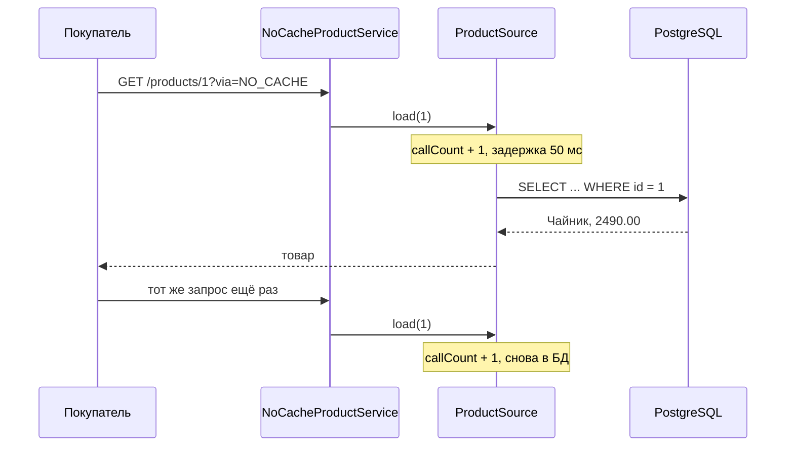

# Сценарий 1. Без кэша

Тест: `src/test/java/io/github/olaaa/cachinglab/scenario/Scenario1NoCacheTest.java`.
Сервис: `NoCacheProductService`.
Ручная проверка: `http/01-no-cache.http`.

## Ситуация

Покупатель открывает карточку товара «Чайник». Каталог каждый раз читает товар из PostgreSQL и ничего не запоминает.

## Что происходит

1. Контроллер вызывает `NoCacheProductService.findById(1)`.
2. Сервис сразу вызывает `ProductSource.load(1)`.
3. `ProductSource` увеличивает счётчик обращений, ждёт 50 мс (в тестах 100 мс) и выполняет `SELECT`.
4. Следующий запрос того же товара проходит тот же путь целиком.

Зачем задержка. В настоящем магазине карточка товара — это не один `SELECT`: соединение таблиц с ценами, остатками и характеристиками, иногда вызов соседнего сервиса. Задержка изображает эту цену, иначе промах кэша в лаборатории был бы незаметен.

Зачем счётчик. Во всех девяти сценариях проверяется одно и то же: сколько раз запрос дошёл до источника. Это и есть то, что кэш должен уменьшать.

## Что проверяет тест

`everyReadGoesToSource`:

1. Перед тестом `ScenarioTestSupport` очищает таблицу, вставляет «Чайник» с ценой 2490.00, сбрасывает кэши и счётчик.
2. Десять раз читает товар 1.
3. Проверяет, что `source.callCount()` равно 10.

Это точка отсчёта. Те же десять чтений в сценарии 2 дадут одно обращение.

### Корректность счётчика

Два теста проверяют, что счётчик считает подписки, то есть реальные обращения к источнику, а не вызовы метода `load`. Для этого тело `ProductSource.load` завёрнуто в `Mono.defer`. Без него `callCount.incrementAndGet()` выполнялся бы при сборке цепочки, один раз на вызов `load`, сколько бы подписок ни было. Репозиторий тут ни при чём: `SELECT` через `DatabaseClient` и так выполняется при каждой подписке.

`sourceIsNotCalledWithoutSubscription`: вызывает `findById(1)` и не подписывается. Обращения к источнику не было, `callCount()` равно 0. Так бывает, например, в `cached.switchIfEmpty(source.load(id))`: аргумент вычисляется сразу, а подписка на него случается только при промахе.

`everySubscriptionIsCounted`: вызывает `findById(1)` один раз и дважды подписывается на результат через `block()`. Между подписками меняет цену в таблице. Вторая подписка видит новую цену, то есть `SELECT` выполнился дважды, и `callCount()` равно 2. Так ведут себя `retry` и любая повторная подписка.

Зачем менять цену. Для проверки счётчика это не нужно: без `Mono.defer` тест падает на сравнении `callCount()` с 2 и без смены цены. Смена цены даёт доказательство, не зависящее от счётчика, что ожидаемое значение 2 — правда. Без неё тест утверждает только «счётчик равен 2», и по нему не видно, кто ошибается без `defer`: может, с `defer` счётчик считает лишнее, а в БД сходили один раз, просто значение использовали дважды. Вторая подписка вернула новую цену — значит, `SELECT` выполнился заново, в БД сходили два раза, и счётчик без `defer` занижает число обращений. Тест сверяет счётчик с фактом, а не с самим собой.

Если закомментировать `Mono.defer` в `ProductSource.load`, оба теста падают: первый получит 1 вместо 0, второй — 1 вместо 2.

## Попробовать вручную

Запустить приложение: `mvn spring-boot:run` (PostgreSQL поднимется из `compose.yaml`). Открыть `http/01-no-cache.http`:

1. `POST /lab/reset`.
2. Несколько раз `GET /products/1?via=NO_CACHE`.
3. `GET /lab/stats` — `sourceCalls` равно числу запросов.

## Без кэша в продакшене

Этот сценарий — не только точка отсчёта. В интернет-магазине большую часть данных не кэшируют вовсе:

- корзина, оформление заказа, оплата — данные одного покупателя, меняются часто, ошибка стоит денег;
- остаток на складе в момент оформления заказа. На витрине его можно показывать из кэша с коротким TTL, но при оформлении проверяют в БД: атомарным `UPDATE … SET stock = stock - 1 WHERE stock > 0` или с блокировкой строки;
- админка: менеджер изменил цену и сразу хочет увидеть результат;
- редкие запросы: кэш, в который почти никогда не попадают, только занимает память.

Кэш добавляют, когда выполнены три условия: чтений намного больше, чем записей; источник дорогой (медленный или перегруженный); бизнес согласен, что данные какое-то время могут быть устаревшими. Каждое из них лучше измерить, а не предположить.

## Как сказать на собеседовании

«Сначала я проверяю, нужен ли кэш: соотношение чтений и записей, стоимость источника, допустимое устаревание. Деньги, остатки при оформлении заказа и корзину я читаю из БД, даже если витрину кэширую».
