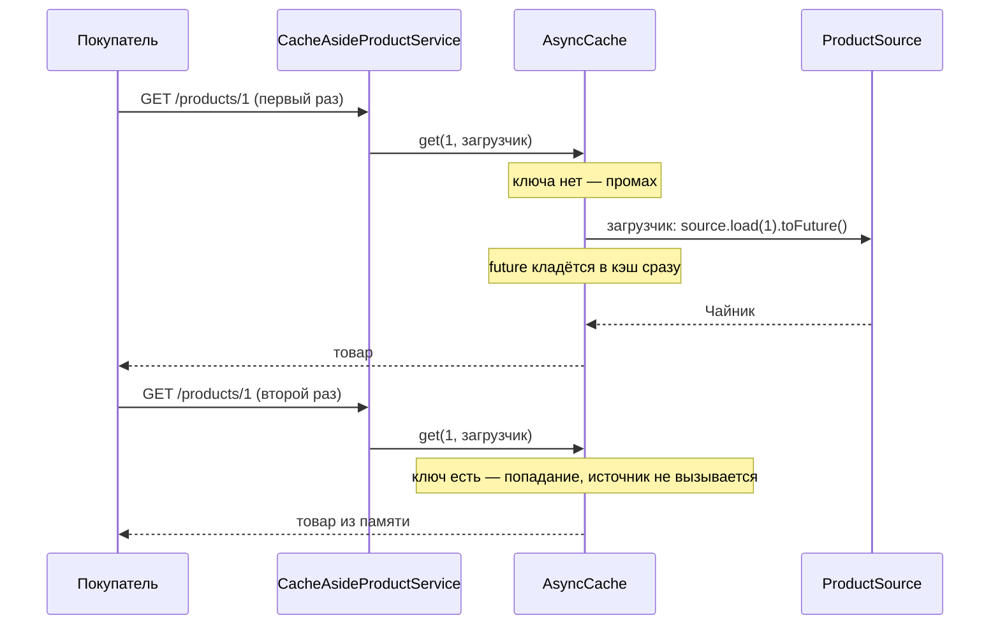

# Сценарий 2. Cache-Aside на AsyncCache и доля попаданий

Тест: `src/test/java/io/github/olaaa/cachinglab/scenario/Scenario2CacheAsideTest.java`.
Сервис: `CacheAsideProductService`.
Ручная проверка: `http/02-cache-aside.http`.

## Ситуация

Карточку «Чайника» открывают тысячи раз в час, а меняется она раз в несколько дней. Нет смысла каждый раз ходить в БД: товар можно держать в памяти сервиса.

## Что такое Cache-Aside

Cache-Aside (кэш сбоку) — самый распространённый шаблон кэширования. Кэш ничего не знает об источнике, решения принимает приложение:

1. Посмотреть в кэш.
2. Есть — вернуть.
3. Нет (промах) — загрузить из источника, положить в кэш, вернуть.
4. При изменении данных — удалить запись из кэша (сценарий 5).

## Что происходит



Код:

```java
this.cache = Caffeine.newBuilder()
        .ticker(cacheTicker)
        .maximumSize(10_000)
        .expireAfterWrite(TIME_TO_LIVE)
        .recordStats()
        .buildAsync();

public Mono<Product> findById(long id) {
    return Mono.fromFuture(() -> cache.get(id, (key, executor) -> source.load(key).toFuture()), true);
}
```

Разбор по частям:

- `maximumSize(10_000)` — без ограничения размера кэш растёт, пока не кончится память. При переполнении Caffeine вытесняет записи, которые, по его оценке, понадобятся реже всего (алгоритм Window TinyLFU).
- `expireAfterWrite` — срок жизни записи, подробно в сценарии 4.
- `recordStats()` — Caffeine начинает считать попадания, промахи, загрузки и вытеснения. Без этого `stats()` возвращает нули.
- `buildAsync()` — кэш хранит не товар, а `CompletableFuture` с товаром. Для реактивного кода это естественно: `Mono` превращается в future через `toFuture()` и обратно через `Mono.fromFuture`.
- `cache.get(key, загрузчик)` — «вернуть, а если нет — загрузить и положить» одной атомарной операцией. Пока загрузка идёт, второй запрос того же ключа получает ту же future и ничего не загружает. Почему это важно — в сценарии 6. Что такое загрузчик — в [docs/caffeine-loader.md](../caffeine-loader.md).
- `Mono.fromFuture(supplier, true)`: supplier — чтобы обращение к кэшу случилось при подписке, а не при сборке цепочки; `true` — чтобы отмена одного подписчика (клиент закрыл вкладку) не отменила общую future, которую ждут другие.

Формально `get(key, загрузчик)` — уже шаг к шаблону Read-Through: кэш сам вызывает загрузку. Но загрузчик передаётся в каждом вызове и знает его сервис, а не кэш, поэтому обычно это всё ещё называют Cache-Aside.

## Доля попаданий

Доля попаданий (hit rate) = попадания / (попадания + промахи). Десять чтений одного товара: один промах, девять попаданий, доля 0,9.

Это главная метрика кэша. Низкая доля значит, что кэш занимает память, но почти не снимает нагрузку: ключей слишком много, TTL слишком короткий или кэш слишком мал. Какая доля хорошая, зависит от данных. Для карточек популярных товаров разумно ждать заметно выше половины — это оценка, а не норма.

`CaffeineCacheMetrics.monitor(meterRegistry, cache, CACHE_NAME)` отдаёт статистику в Micrometer: метрики `cache.gets` с тегом `result=hit` или `result=miss`, `cache.puts`, `cache.evictions`, `cache.size`. В продакшене по ним строят графики и тревоги.

## Что проверяют тесты

`onlyFirstReadGoesToSource`:

1. Запоминает статистику до теста. Статистику Caffeine нельзя обнулить, и она общая для всех тестов контекста, поэтому тест считает разницу.
2. Десять раз читает товар 1.
3. Проверяет: обращений к источнику — 1; промахов — 1; попаданий — 9; доля — 0,9.

`hitsAndMissesAreExportedToMicrometer`:

1. Четыре раза читает товар.
2. Читает из `MeterRegistry` счётчики `cache.gets` с тегами `hit` и `miss`.
3. Проверяет, что они совпадают со статистикой Caffeine: метрики действительно подключены.

## Попробовать вручную

`http/02-cache-aside.http`: сброс, несколько чтений, `GET /lab/stats` (`sourceCalls` = 1, `cacheAsideHitRate` растёт), затем `GET /actuator/metrics/cache.gets?...`.

## Что важно заметить

- Объект в кэше общий для всех запросов. Его нельзя менять: `Product` — record, поэтому изменить его поля нельзя. Если положить в кэш изменяемый объект, один запрос может испортить данные всем остальным.
- Кэш локальный: у каждой реплики сервиса своя копия. Три реплики — три промаха на один товар, а удаление записи (сценарий 5) срабатывает только на той реплике, которая обработала изменение. Это тема этапа 2 (Redis).

## Насколько часто встречается

Чаще всех остальных. Почти любой кэш в обычном сервисе — это Cache-Aside, написанный вручную или через `@Cacheable` (сценарий 3).

## Как сказать на собеседовании

«По умолчанию я беру Cache-Aside: при промахе загружаю и кладу, при изменении удаляю. Загрузку делаю атомарной — `Caffeine.get(key, loader)`, а не `getIfPresent` плюс `put`. Обязательно задаю `maximumSize` и TTL и включаю `recordStats`, чтобы видеть долю попаданий в метриках».
