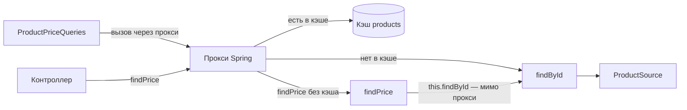

# Сценарий 3. `@Cacheable` на `Mono`, вызов изнутри бина и `sync = true`

Тест: `src/test/java/io/github/olaaa/cachinglab/scenario/Scenario3CacheableTest.java`.
Сервисы: `AnnotatedProductService`, `ProductPriceQueries`. Настройка: `config/CacheConfiguration`.
Ручная проверка: `http/03-cacheable.http`.

## Ситуация

Тот же Cache-Aside, что в сценарии 2, но так, как его обычно пишут в Spring-проектах: одной аннотацией над методом.

```java
@Cacheable(CACHE_NAME)
public Mono<Product> findById(long id) {
    return source.load(id);
}
```

## Как это работает

`@EnableCaching` заставляет Spring завернуть бин `AnnotatedProductService` в прокси — объект-обёртку, подкласс, который Spring создаёт сам. Другие бины получают не сам сервис, а прокси. Вызов через прокси проходит через `CacheInterceptor`:

1. Ключ — аргумент метода: `1`. Если аргументов несколько, Spring собирает из них `SimpleKey`.
2. Если в кэше `products` есть значение по ключу — прокси возвращает `Mono` с этим значением, тело метода не вызывается.
3. Если нет — прокси вызывает метод, подписывается на его `Mono` и, когда тот отдаст товар, кладёт товар в кэш.

Кэшируется значение, которое отдал `Mono`, а не сам объект `Mono`. Так Spring умеет с версии Framework 6.1; до неё в кэш попадал объект `Mono`, и это было ошибкой. Для Caffeine нужен асинхронный режим менеджера:

```java
cacheManager.setAsyncCacheMode(true);
```

Без него реактивный `@Cacheable` с `CaffeineCacheManager` не работает: Spring опирается на `Cache.retrieve`, а его поддерживает только асинхронный кэш.

## Ловушка: вызов изнутри того же бина

```java
public Mono<BigDecimal> findPrice(long id) {
    return findById(id).map(Product::price);
}
```



`findPrice` вызывает `findById` через `this`. `this` — это сам сервис, а не прокси, поэтому `CacheInterceptor` не участвует: каждый вызов идёт в источник, даже если товар уже лежит в кэше. Ошибки нет, предупреждения нет — кэш просто молча не работает. Так же ведут себя `@Transactional`, `@Async`, `@Retryable` и другие аннотации, которые работают через прокси.

Как исправить:

- вынести вызов в другой бин — так сделано в `ProductPriceQueries`, это самый понятный способ;
- внедрить в сервис ссылку на собственный прокси (`@Lazy` поле своего же типа) — работает, но читается хуже;
- переключить кэширование на AspectJ (`@EnableCaching(mode = AdviceMode.ASPECTJ)`): аспект вплетается в байт-код, и вызов через `this` тоже перехватывается. Требует настройки сборки.

Ещё два частых промаха того же рода: `@Cacheable` на `private` методе и на `final` методе. Прокси-подкласс не может их переопределить, и аннотация молча игнорируется.

## `sync = true`

### Какую задачу решает

Без `sync` `@Cacheable` работает как наивный Cache-Aside из сценария 6: «посмотреть в кэше; нет — вызвать метод; когда метод отдаст значение — положить в кэш». Между проверкой и записью проходит всё время загрузки. Если 200 запросов пришли за холодным товаром одновременно, все 200 увидят пустой кэш и все 200 вызовут метод. Это лавина промахов.

```java
@Cacheable(cacheNames = CACHE_NAME, sync = true)
public Mono<Product> findByIdSync(long id) {
    return source.load(id);
}
```

С `sync = true` Spring вызывает не пару «прочитать, потом записать», а одну операцию кэша `retrieve(key, valueLoader)`. Javadoc `Cache.retrieve`: «implementations should ensure that the loading operation is synchronized so that the specified valueLoader is only called once in case of concurrent access on the same key». `CaffeineCache` в асинхронном режиме превращает её в `AsyncCache.get(key, loader)` — тот же приём, что в сценарии 2: первый промах кладёт в кэш future загрузки, остальные получают эту же future и ждут её.

### Ограничения

Javadoc `@Cacheable.sync`: с `sync = true` не поддерживается `unless`, кэш можно указать только один, и другие кэш-операции на том же методе комбинировать нельзя. Это «hint»: объединит ли провайдер загрузки, зависит от провайдера. Caffeine объединяет.

### Ловушка: загрузка без подписки

С `sync = true` кэш опрашивается и загрузка на промахе запускается в момент вызова метода, а не при подписке на `Mono`. В `CacheAspectSupport.ReactiveCachingHandler.executeSynchronized` (Spring Framework 7.0.10):

```java
return adapter.fromPublisher(Mono.fromFuture(
        doRetrieve(cache, key,
                () -> Mono.from(adapter.toPublisher(invokeOperation(invoker))).doOnError(...).toFuture()))
```

`Mono.fromFuture` получает готовую future, а не лямбду, поэтому `doRetrieve` выполняется сразу, при вызове метода. На промахе Caffeine тут же вызывает загрузчик, а тот подписывается на `Mono` метода через `toFuture()`. Без `sync` вызов метода только собирает цепочку, и источник не трогается, пока нет подписки.

Обычно это незаметно: в WebFlux на `Mono` подписываются сразу. Но записи вида `cached.switchIfEmpty(service.findByIdSync(id))` при `sync = true` запустят загрузку при каждом вызове, даже если запасной вариант не понадобится. Защита — `Mono.defer(() -> service.findByIdSync(id))` в месте вызова.

## Что проверяют тесты

`cacheableCachesValueOfMono`: пять чтений через прокси — одно обращение к источнику.

`selfInvocationBypassesCache`:

1. `findById(1)` через прокси — одно обращение, товар в кэше.
2. Три раза `findPrice(1)`. Цена правильная, но каждый вызов дошёл до источника.
3. Итого обращений — 4, хотя товар всё время лежал в кэше.

`callFromAnotherBeanGoesThroughProxy`: три раза `ProductPriceQueries.findPrice(1)` — одно обращение. Тот же код, но вызов идёт через прокси.

`cacheableWithoutSyncLetsEveryConcurrentMissThrough`: 200 одновременных чтений холодного товара через `findById` — 200 обращений к источнику.

`cacheableWithSyncCoalescesConcurrentMisses`: те же 200 чтений через `findByIdSync` — одно обращение.

`cacheableWithSyncStartsLoadingWithoutSubscription`:

1. `findById(1)` без подписки — обращений 0.
2. `findByIdSync(1)` без подписки — обращений уже 1.
3. Две подписки на тот же `Mono` через `block()` — обращений по-прежнему 1: обе получают результат одной future.

## Попробовать вручную

`http/03-cacheable.http`:

1. Сброс, несколько `GET /products/1?via=ANNOTATED`, `sourceCalls` = 1.
2. Несколько `GET /products/1/price?via=SELF_INVOCATION` — `sourceCalls` растёт на каждый вызов.
3. Несколько `GET /products/1/price?via=OTHER_BEAN` — больше не растёт.

Одновременные промахи — в терминале, как в сценарии 6:

```bash
curl -s -X POST http://localhost:8080/lab/reset
seq 200 | xargs -P 200 -I{} curl -s -o /dev/null "http://localhost:8080/products/2?via=ANNOTATED"
curl -s http://localhost:8080/lab/stats

curl -s -X POST http://localhost:8080/lab/reset
seq 200 | xargs -P 200 -I{} curl -s -o /dev/null "http://localhost:8080/products/2?via=ANNOTATED_SYNC"
curl -s http://localhost:8080/lab/stats
```

Для `ANNOTATED` `sourceCalls` будет заметно больше 1 (точное число зависит от того, как быстро `curl` успеет открыть соединения), для `ANNOTATED_SYNC` — 1.

## `@Cacheable` или ручной кэш

`@Cacheable` удобен, когда хватает простого «по ключу положить, по ключу удалить». Ручной `AsyncCache` (сценарий 2) нужен, когда хочется управлять больше: свой TTL для разных значений (сценарий 8), `refreshAfterWrite` (сценарий 7), пакетная загрузка, метрики конкретного кэша.

## Насколько часто встречается

Очень часто: в Spring-проектах кэш чаще всего подключают именно так. Ловушка с вызовом через `this` — одна из самых частых ошибок в Spring вообще (это оценка по практике, а не статистика).

## Как сказать на собеседовании

«`@Cacheable` работает через прокси, поэтому вызов изнутри того же бина, `private` и `final` методы кэш обходят. Для реактивных методов с Spring 6.1 кэшируется значение `Mono`, для Caffeine нужен `setAsyncCacheMode(true)`. Для горячих ключей ставлю `sync = true`, чтобы одновременные промахи загружали значение один раз. Для реактивных методов помню, что с `sync = true` загрузка начинается при вызове метода, а не при подписке».
