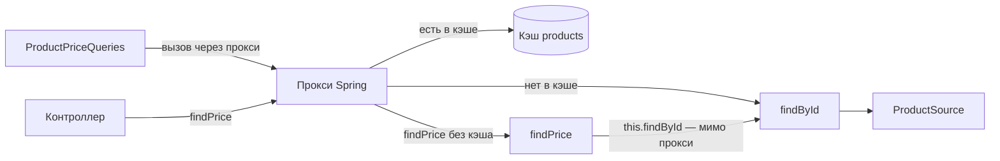

# Сценарий 3. `@Cacheable` на `Mono` и вызов изнутри бина

Тест: `src/test/java/io/github/olaaa/cachinglab/scenario/Scenario3CacheableTest.java`.
Сервисы: `AnnotatedProductService`, `ProductPriceQueries`. Настройка: `config/CacheConfiguration`.
Ручная проверка: `http/03-cacheable.http`.

## Ситуация

Тот же Cache-Aside, что в сценарии 2, но так, как его обычно пишут в Spring-проектах: одной аннотацией над методом.

```java
@Cacheable(CACHE_NAME)
public Mono<Product> findById(long id) {
    return source.load(id);
}
```

## Как это работает

`@EnableCaching` заставляет Spring завернуть бин `AnnotatedProductService` в прокси — объект-обёртку, подкласс, который Spring создаёт сам. Другие бины получают не сам сервис, а прокси. Вызов через прокси проходит через `CacheInterceptor`:

1. Ключ — аргумент метода: `1`. Если аргументов несколько, Spring собирает из них `SimpleKey`.
2. Если в кэше `products` есть значение по ключу — прокси возвращает `Mono` с этим значением, тело метода не вызывается.
3. Если нет — прокси вызывает метод, подписывается на его `Mono` и, когда тот отдаст товар, кладёт товар в кэш.

Кэшируется значение, которое отдал `Mono`, а не сам объект `Mono`. Так Spring умеет с версии Framework 6.1; до неё в кэш попадал объект `Mono`, и это было ошибкой. Для Caffeine нужен асинхронный режим менеджера:

```java
cacheManager.setAsyncCacheMode(true);
```

Без него реактивный `@Cacheable` с `CaffeineCacheManager` не работает: Spring опирается на `Cache.retrieve`, а его поддерживает только асинхронный кэш.

## Ловушка: вызов изнутри того же бина

```java
public Mono<BigDecimal> findPrice(long id) {
    return findById(id).map(Product::price);
}
```



`findPrice` вызывает `findById` через `this`. `this` — это сам сервис, а не прокси, поэтому `CacheInterceptor` не участвует: каждый вызов идёт в источник, даже если товар уже лежит в кэше. Ошибки нет, предупреждения нет — кэш просто молча не работает. Так же ведут себя `@Transactional`, `@Async`, `@Retryable` и другие аннотации, которые работают через прокси.

Как исправить:

- вынести вызов в другой бин — так сделано в `ProductPriceQueries`, это самый понятный способ;
- внедрить в сервис ссылку на собственный прокси (`@Lazy` поле своего же типа) — работает, но читается хуже;
- переключить кэширование на AspectJ (`@EnableCaching(mode = AdviceMode.ASPECTJ)`): аспект вплетается в байт-код, и вызов через `this` тоже перехватывается. Требует настройки сборки.

Ещё два частых промаха того же рода: `@Cacheable` на `private` методе и на `final` методе. Прокси-подкласс не может их переопределить, и аннотация молча игнорируется.

## `sync = true`

Без него `@Cacheable` не объединяет одновременные промахи: если двадцать запросов пришли за холодным товаром одновременно, метод выполнится двадцать раз (подробно — сценарий 6). `@Cacheable(sync = true)` заставляет Spring загружать ключ один раз, остальные ждут. Для `Mono` и `Flux` это тоже работает: в `CacheAspectSupport.executeSynchronized` есть отдельная ветка для реактивных типов (проверено по исходнику Spring Framework 7).

## Что проверяют тесты

`cacheableCachesValueOfMono`: пять чтений через прокси — одно обращение к источнику.

`selfInvocationBypassesCache`:

1. `findById(1)` через прокси — одно обращение, товар в кэше.
2. Три раза `findPrice(1)`. Цена правильная, но каждый вызов дошёл до источника.
3. Итого обращений — 4, хотя товар всё время лежал в кэше.

`callFromAnotherBeanGoesThroughProxy`: три раза `ProductPriceQueries.findPrice(1)` — одно обращение. Тот же код, но вызов идёт через прокси.

## Попробовать вручную

`http/03-cacheable.http`:

1. Сброс, несколько `GET /products/1?via=ANNOTATED`, `sourceCalls` = 1.
2. Несколько `GET /products/1/price?via=SELF_INVOCATION` — `sourceCalls` растёт на каждый вызов.
3. Несколько `GET /products/1/price?via=OTHER_BEAN` — больше не растёт.

## `@Cacheable` или ручной кэш

`@Cacheable` удобен, когда хватает простого «по ключу положить, по ключу удалить». Ручной `AsyncCache` (сценарий 2) нужен, когда хочется управлять больше: свой TTL для разных значений (сценарий 8), `refreshAfterWrite` (сценарий 7), пакетная загрузка, метрики конкретного кэша.

## Насколько часто встречается

Очень часто: в Spring-проектах кэш чаще всего подключают именно так. Ловушка с вызовом через `this` — одна из самых частых ошибок в Spring вообще (это оценка по практике, а не статистика).

## Как сказать на собеседовании

«`@Cacheable` работает через прокси, поэтому вызов изнутри того же бина, `private` и `final` методы кэш обходят. Для реактивных методов с Spring 6.1 кэшируется значение `Mono`, для Caffeine нужен `setAsyncCacheMode(true)`. Для горячих ключей ставлю `sync = true`, чтобы одновременные промахи загружали значение один раз».
