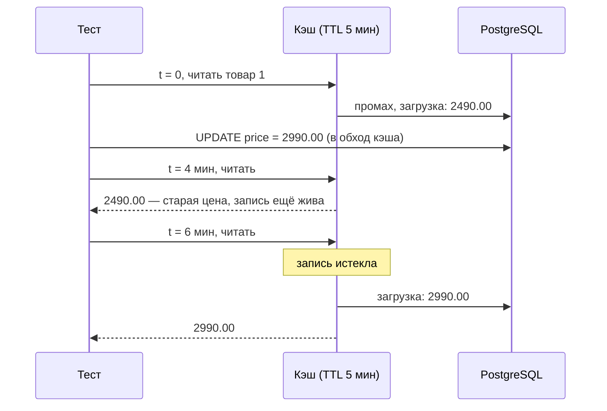

# Сценарий 4. TTL и устаревание

Тест: `src/test/java/io/github/olaaa/cachinglab/scenario/Scenario4TimeToLiveTest.java`.
Сервис: `CacheAsideProductService` (`TIME_TO_LIVE` = 5 минут).
Ручная проверка: `http/04-time-to-live.http`.

## Ситуация

Ночью цены загружаются из учётной системы прямо в таблицу `product`, минуя каталог. Каталог об изменении не знает, удалить запись из кэша некому. Покупатели видят старую цену, пока запись не истечёт сама.

TTL (time to live, срок жизни) — сколько запись живёт в кэше после записи. Это предохранитель: какой бы ни была инвалидация, данные не бывают старше TTL.

## Что происходит



Код:

```java
Caffeine.newBuilder()
        .ticker(cacheTicker)
        .expireAfterWrite(TIME_TO_LIVE)
```

## Как тест управляет временем

Ждать пять минут в тесте нельзя. Caffeine узнаёт текущее время не из системных часов напрямую, а через `Ticker`. В приложении это `Ticker.systemTicker()`, в тестах — `ManualTicker`: его время стоит на месте, пока тест не вызовет `ticker.advance(...)`. Так проверяется любой TTL без `sleep` и без случайных падений.

Тонкость, которую пришлось учесть. Асинхронный кэш отмечает время записи, когда загрузка завершилась, — в колбэке future. Колбэки `CompletableFuture` выполняются в обратном порядке регистрации, поэтому `block()` может вернуть товар раньше, чем Caffeine запишет время. Если сразу сдвинуть часы, запись получит время уже после сдвига и «помолодеет». Поэтому тест после первого чтения ждёт, пока у записи появится возраст: `awaitEntryWritten(...)`.

## Что проверяет тест

`cacheServesStaleValueUntilTimeToLiveExpires`:

1. Читает товар: 2490.00, одно обращение к источнику.
2. Ждёт, пока Caffeine отметит время записи.
3. Меняет цену в БД на 2990.00 напрямую через репозиторий — кэш об этом не знает.
4. Сдвигает часы на 4 минуты, читает: всё ещё 2490.00, обращений по-прежнему 1.
5. Сдвигает ещё на 2 минуты (всего 6 > 5), читает: 2990.00, обращений 2.

## Попробовать вручную

Здесь время настоящее, придётся подождать пять минут. `http/04-time-to-live.http`:

1. Сброс, `GET /products/1?via=CACHE_ASIDE`.
2. В терминале в папке проекта изменить цену в обход приложения:

   ```bash
   docker compose exec postgres psql -U catalog -c "UPDATE product SET price = 2990.00 WHERE id = 1"
   ```

3. Повторить `GET` — старая цена.
4. Через пять минут после шага 1 — новая цена, `sourceCalls` = 2.

## `expireAfterWrite` или `expireAfterAccess`

- `expireAfterWrite` — отсчёт от момента записи. Запись гарантированно перечитывается не реже, чем раз в TTL. Это то, что нужно для данных, которые меняются.
- `expireAfterAccess` — отсчёт от последнего чтения. Популярный товар читают каждую секунду, и его запись не истекает никогда — старая цена может жить вечно. Подходит для данных, которые не меняются, но занимают память: например, скомпилированные шаблоны или разобранные настройки.
- `expireAfter(Expiry)` — свой срок для каждой записи. Используется в сценарии 8.

## Как выбрать TTL

Это вопрос к бизнесу, а не к разработчику: «Сколько можно показывать старое значение?». Ориентиры для магазина (оценка, не норма):

- описание, фото, характеристики — часы;
- цена на витрине — минуты, при оформлении заказа — из БД;
- остаток на витрине — секунды или вовсе без кэша;
- дерево категорий — десятки минут.

Чем короче TTL, тем чаще промахи и ниже доля попаданий. Чем длиннее, тем дольше живут ошибки, если инвалидация не сработала.

## Насколько часто встречается

Практически в каждом кэше. Кэш без TTL допустим только для данных, которые не меняются за время жизни приложения.

## Как сказать на собеседовании

«TTL — верхняя граница устаревания и страховка, если инвалидация не сработала или изменение прошло в обход приложения. Для меняющихся данных — `expireAfterWrite`, не `expireAfterAccess`: иначе горячая запись не истечёт никогда. Значение TTL — это бизнес-вопрос, сколько можно показывать старые данные».
