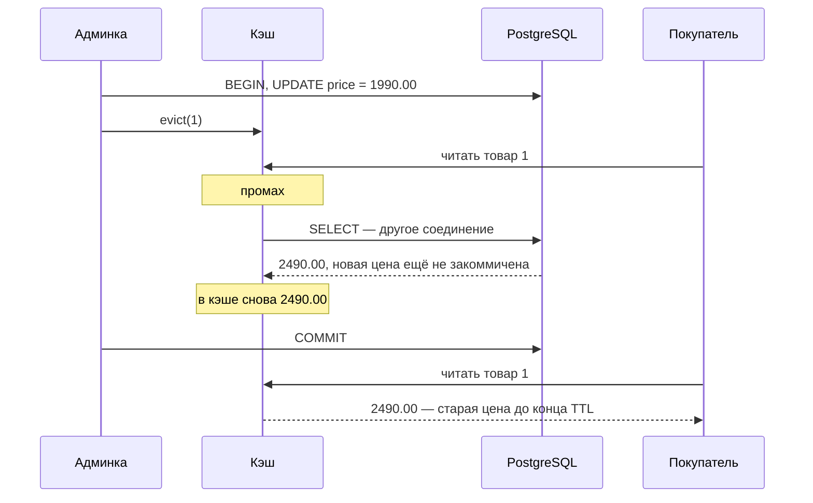
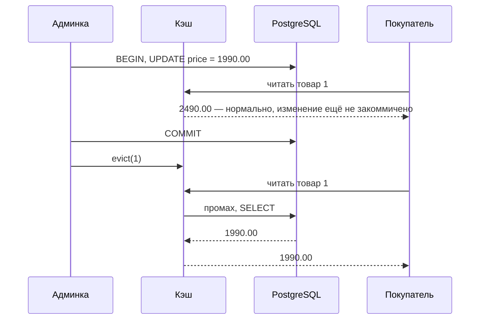

# Сценарий 5. Инвалидация до коммита и после

Тест: `src/test/java/io/github/olaaa/cachinglab/scenario/Scenario5InvalidationTest.java`.
Сервис: `ProductPriceService`.
Ручная проверка: `http/05-invalidation.http` (только правильный порядок).

## Ситуация

Менеджер в админке снижает цену «Чайника» с 2490.00 до 1990.00. Изменение идёт через приложение, поэтому приложение знает, что запись в кэше устарела, и удаляет её — это и есть инвалидация. Ждать TTL не нужно: следующий покупатель получит новую цену.

Вопрос сценария — в каком порядке: сначала удалить из кэша, потом закоммитить транзакцию, или наоборот.

## Почему удалять, а не обновлять

Можно было бы положить новую цену в кэш сразу. Но если два менеджера меняют цену почти одновременно, их записи в кэш могут прийти в обратном порядке: в БД останется цена второго, в кэше — первого. Удаление такой гонки не создаёт: следующее чтение загрузит из БД то, что там действительно лежит.

## Неправильно: удалить до коммита



Между удалением и коммитом есть окно. Любое чтение в это окно получает промах, загружает из БД старую цену (новая ещё не видна другим соединениям при уровне изоляции READ COMMITTED) и кладёт её обратно в кэш. После коммита в БД 1990.00, а в кэше 2490.00 — и так до конца TTL, 5 минут.

## Правильно: удалить после коммита



Что бы ни попало в кэш, пока транзакция открыта, удаление после коммита это уберёт.

Код `ProductPriceService.changePrice`:

```java
return transactionalOperator.transactional(repository.updatePrice(id, price))
        .flatMap(updatedRows -> {
            if (updatedRows == 0) {
                return Mono.just(false);
            }
            return Mono.fromRunnable(() -> cacheAsideProductService.evict(id)).thenReturn(true);
        });
```

`transactional(Mono)` отдаёт значение только после коммита: внутри стоит `singleOrEmpty`, который ждёт завершения транзакции. Поэтому `evict` в `flatMap` выполняется уже после коммита.

## Как тест воспроизводит гонку без потоков

Настоящая гонка зависит от времени: поймать параллельное чтение ровно между удалением и коммитом трудно, и такой тест иногда проходил бы, иногда нет. Тест делает окно детерминированным: ставит чтение через кэш прямо внутрь транзакции.

```java
transactionalOperator.transactional(
        repository.updatePrice(KETTLE_ID, NEW_PRICE)
                .then(Mono.fromRunnable(() -> cacheAsideProductService.evict(KETTLE_ID)))
                .then(cacheAsideProductService.findById(KETTLE_ID)))
        .block();
```

Почему чтение внутри транзакции ведёт себя как чужой запрос. Реактивный Spring хранит транзакцию в Reactor Context — в данных, которые передаются по цепочке подписки. Загрузчик кэша подписывается на `source.load(key)` через `toFuture()`, а `toFuture()` подписывается без контекста вызывающего. Загрузчик не видит транзакцию, берёт из пула другое соединение и читает только закоммиченные данные — как настоящий параллельный покупатель.

## Что проверяют тесты

`evictBeforeCommitLeavesStaleValueInCache` — неправильный порядок:

1. Читает товар — 2490.00 в кэше.
2. В одной транзакции: `UPDATE` на 1990.00, удаление из кэша, чтение через кэш (оно загружает 2490.00).
3. После коммита: в БД 1990.00, а через кэш — 2490.00.

`evictAfterCommitRemovesValueReadDuringTransaction` — правильный порядок:

1. Читает товар — 2490.00 в кэше.
2. В транзакции: `UPDATE` и чтение через кэш (получает 2490.00 — изменение ещё не закоммичено).
3. После коммита — удаление.
4. Чтение через кэш — 1990.00.

`changePriceEvictsAfterCommit` — то же через сервис: после `changePrice` кэш отдаёт новую цену, обращений к источнику 2.

`changePriceOfMissingProductReturnsFalse` — цену несуществующего товара изменить нельзя, сервис возвращает `false`.

## Попробовать вручную

Неправильный порядок вручную не поймать — только в тесте. Правильный — `http/05-invalidation.http`: сброс, чтение, `PUT /products/1/price` с `{"price": 1990.00}`, чтение — новая цена сразу, `sourceCalls` = 2.

## Что остаётся за кадром

- Остаточная гонка. Покупатель начал загрузку до коммита, а закончил после удаления — его ответ со старой ценой мог бы вернуться в кэш. В Caffeine `invalidate` во время идущей загрузки убирает и её future, поэтому запоздавший ответ в кэш не попадает (по документации и устройству Caffeine; в лаборатории отдельным тестом не проверено). В Redis такой защиты нет — это тема этапа 2.
- Несколько реплик. Кэш локальный, `evict` срабатывает только на реплике, которая обработала изменение. На остальных старая цена живёт до TTL. Решения — общий кэш в Redis или рассылка событий об удалении всем репликам — тоже этап 2.
- Сбой между коммитом и удалением. Если приложение упало сразу после коммита, удаления не будет, и спасёт только TTL. Если это недопустимо, удаление делают по событию из БД: Transactional Outbox или чтение журнала изменений (CDC).
- `@CacheEvict`. В обычном, нереактивном Spring есть `TransactionAwareCacheDecorator` (`cacheManager.setTransactionAware(true)`): он откладывает `put` и `evict` до коммита. Он опирается на привязку транзакции к потоку, поэтому в реактивном коде, вероятно, не поможет — это вывод из устройства, в лаборатории не проверялось.

## Насколько часто встречается

Везде, где данные меняются через приложение. И очень часто сделано неправильно: удаление стоит внутри транзакционного метода, то есть до коммита (оценка по практике).

## Как сказать на собеседовании

«При изменении данных я удаляю запись, а не обновляю её, и делаю это после коммита. Если удалить до коммита, параллельное чтение успеет положить в кэш старое значение. TTL остаётся страховкой на случай, если удаление не случилось. При нескольких репликах локальный кэш нужно инвалидировать на всех: через общий Redis или рассылку событий».
