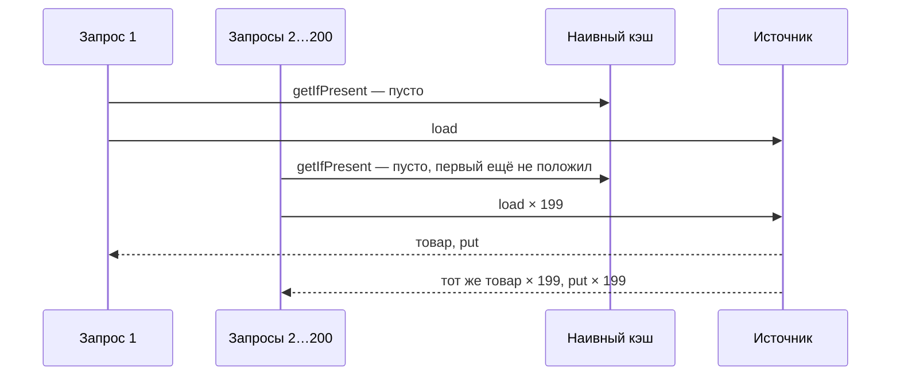
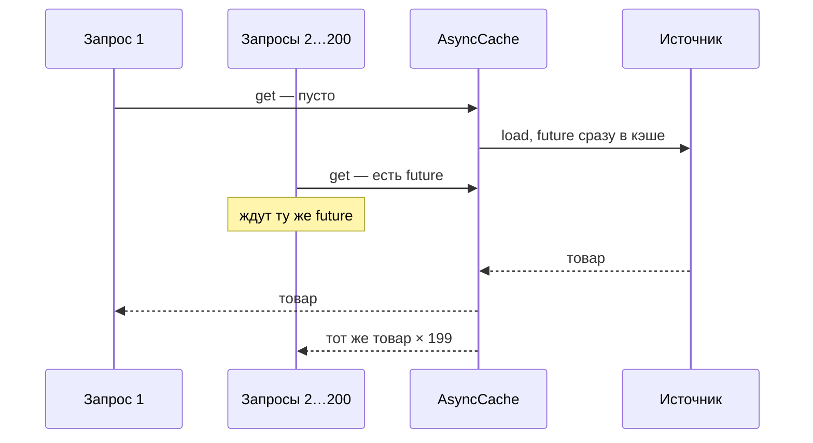

# Сценарий 6. Лавина промахов

Тест: `src/test/java/io/github/olaaa/cachinglab/scenario/Scenario6StampedeTest.java`.
Сервисы: `NaiveCacheAsideProductService`, `CacheAsideProductService`.
Ручная проверка: `http/06-stampede.http` и команды ниже.

## Ситуация

В 10:00 начинается распродажа, рассылка со ссылкой на «Кофемолку» уходит сотне тысяч покупателей. За одну секунду приходят сотни запросов одной карточки, а её в кэше нет: кэш только что очищен деплоем, или у записи как раз истёк TTL. Если каждый запрос сам пойдёт в БД, сотни одинаковых запросов ударят по ней одновременно.

Это называют лавиной промахов (cache stampede, thundering herd). Связанные случаи:

- холодный старт — после рестарта или деплоя кэш пуст, и все запросы первых секунд промахиваются;
- горячий ключ — одна запись, которую читают намного чаще остальных; её истечение превращается в лавину.

## Наивный кэш

```java
Product cachedProduct = cache.getIfPresent(id);
if (cachedProduct != null) {
    return Mono.just(cachedProduct);
}
return source.load(id).doOnNext(product -> cache.put(id, product));
```

Проверка «нет в кэше» и запись «положил» разделены всем временем загрузки. Все, кто пришёл в это время, тоже видят пустой кэш и тоже идут в источник.



## Кэш, который объединяет промахи

```java
cache.get(id, (key, executor) -> source.load(key).toFuture())
```

`AsyncCache` кладёт future в кэш сразу, до того как загрузка закончится. Второй и следующие запросы находят эту незавершённую future и ждут её — загрузку они не запускают.



## Что проверяют тесты

Оба теста делают одно и то же — 200 одновременных чтений холодного товара:

```java
Flux.range(0, CONCURRENT_REQUESTS)
        .flatMap(requestNumber -> reader.apply(KETTLE_ID), CONCURRENT_REQUESTS)
        .collectList()
        .block();
```

`flatMap` с параллельностью 200 подписывается на все 200 чтений сразу, не дожидаясь ответов. Источник отвечает через 100 мс, а подписка на 200 чтений занимает доли миллисекунды, поэтому все 200 приходят раньше первого ответа.

- `naiveCacheLetsEveryConcurrentMissThrough` — 200 ответов, 200 обращений к источнику.
- `asyncCacheCoalescesConcurrentMisses` — 200 ответов, одно обращение.

## Попробовать вручную

Запустить приложение, в терминале:

```bash
curl -s -X POST http://localhost:8080/lab/reset
seq 200 | xargs -P 200 -I{} curl -s -o /dev/null "http://localhost:8080/products/2?via=NAIVE"
curl -s http://localhost:8080/lab/stats

curl -s -X POST http://localhost:8080/lab/reset
seq 200 | xargs -P 200 -I{} curl -s -o /dev/null "http://localhost:8080/products/2?via=CACHE_ASIDE"
curl -s http://localhost:8080/lab/stats
```

Для `NAIVE` `sourceCalls` будет заметно больше 1 (точное число зависит от того, как быстро `curl` успеет открыть соединения), для `CACHE_ASIDE` — 1.

## Чем ещё защищаются

- Объединение промахов в одном процессе: `AsyncCache.get(key, loader)`, `LoadingCache`, `@Cacheable(sync = true)` (сценарий 3). Это делать стоит всегда, оно почти ничего не стоит.
- Фоновое обновление до истечения (Refresh-Ahead, сценарий 7): горячая запись перечитывается в фоне и не истекает под нагрузкой.
- Разброс TTL (jitter): записи, загруженные одновременно (например, при прогреве), получают немного разный срок и не истекают все в одну секунду. Важно для Redis — этап 2.
- Прогрев: при старте загрузить самые популярные товары заранее, до того как реплика начнёт принимать трафик.
- Между репликами объединение в процессе не помогает: десять реплик — до десяти загрузок одного ключа. Обычно этого достаточно. Если нет — распределённая блокировка на загрузку или общий кэш (этапы 2 и 3).

## Насколько часто встречается

Проблема есть в любом нагруженном магазине: популярные товары, распродажи, рассылки, деплои. Но защита обычно получается почти бесплатно, если правильно пользоваться Caffeine (`get(key, loader)`, а не `getIfPresent` плюс `put`). Всерьёз заниматься лавиной приходится для горячих ключей и медленных источников.

## Как сказать на собеседовании

«Наивный Cache-Aside, где проверка и запись разделены временем загрузки, пропускает к источнику все одновременные промахи. Я делаю загрузку атомарной: в Caffeine `get(key, loader)` или асинхронный кэш, где все ждут одну future, в Spring — `sync = true`. Для горячих ключей добавляю фоновое обновление, для Redis — разброс TTL».
