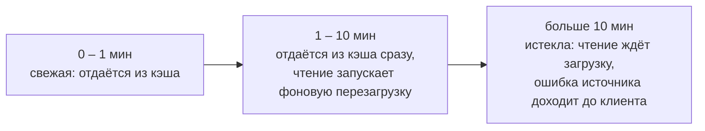

# Сценарий 7. Refresh-Ahead и упавший источник

Refresh-Ahead — «упреждающее обновление», то есть обновление заранее: `refresh` — обновить, перечитать; `ahead` — заранее, наперёд. Популярная запись перечитывается из источника в фоне до того, как истечёт её срок, а покупатели тем временем получают старое значение без ожидания.

Тест: `src/test/java/io/github/olaaa/cachinglab/scenario/Scenario7RefreshAheadTest.java`.
Сервис: `RefreshAheadProductService` (`REFRESH_AFTER` = 1 минута, `EXPIRE_AFTER` = 10 минут).
Ручная проверка: `http/07-refresh-ahead.http`.

## Ситуация

Дерево категорий и меню нужны на каждой странице магазина. Собирать их дорого, а меняются они редко, и если меню на минуту отстанет от админки, никто не пострадает. Хочется двух вещей:

- ни один покупатель не должен ждать, пока меню перезагружается;
- если сервис категорий или БД ненадолго упадут, магазин должен продолжать показывать меню.

С обычным TTL (сценарий 4) не выполняется ни то, ни другое: запись истекает, и первый покупатель после этого ждёт загрузку, а если источник лежит — получает ошибку.

## Что происходит

```java
Caffeine.newBuilder()
        .ticker(cacheTicker)
        .refreshAfterWrite(REFRESH_AFTER)
        .expireAfterWrite(EXPIRE_AFTER)
        .<Long, Product>buildAsync((key, executor) -> source.load(key).toFuture());
```

У записи три возраста:



- Меньше минуты — обычное попадание.
- От минуты до десяти — чтение сразу получает текущее значение, а Caffeine в фоне вызывает загрузчик. Когда загрузка закончится, запись заменяется и её возраст снова ноль. Если загрузка упала, Caffeine пишет WARN в лог и оставляет старое значение.
- Больше десяти минут — запись удалена, следующее чтение ждёт загрузку, как при обычном промахе.

Важно: перезагрузку запускает чтение, а не таймер. Если запись никто не читает, она не обновляется и через десять минут просто истекает. Поэтому редко читаемые данные так не обновить — для них нужна загрузка по расписанию.

Ещё одно следствие: пока источник лежит, каждое чтение записи старше минуты пробует перезагрузить её снова. Источник получает поток попыток, по одной на чтение (одновременные попытки Caffeine объединяет). Если источник после падения нельзя нагружать, нужен Circuit Breaker перед ним.

`refreshAfterWrite` работает только с загрузчиком: кэш должен сам знать, как перечитать значение, ведь клиент в этот момент ничего не передаёт. Без загрузчика Caffeine не соберёт кэш. Подробно — [docs/caffeine-loader.md](../caffeine-loader.md).

`EXPIRE_AFTER` — граница допустимой старости. Без неё при долгой аварии магазин показывал бы сколь угодно старые данные.

### Когда значение не истекает

Значение в кэше не истечёт, пока после каждого обновления этого значения хотя бы одно чтение приходит в окно от `REFRESH_AFTER` до `EXPIRE_AFTER` после этого обновления, и источник при этом отвечает.

Обновление — это и первая загрузка на промахе, и каждая успешная фоновая перезагрузка. После каждого обновления оба срока отсчитываются заново: в Javadoc Caffeine и `refreshAfterWrite`, и `expireAfterWrite` считают время «после создания записи или последней замены её значения». Неудачная перезагрузка значение не заменяет, поэтому ничего не сбрасывает: значение истекает через `EXPIRE_AFTER` от последнего успешного обновления.

Проверено запуском: возраст по обоим срокам (`policy().refreshAfterWrite().ageOf()` и `policy().expireAfterWrite().ageOf()`) до и после успешной перезагрузки.

```text
после загрузки:                   refreshAge=PT0S     expireAge=PT0S
через 61 секунду:                 refreshAge=PT1M1S   expireAge=PT1M1S
после успешной перезагрузки:      refreshAge=PT0S     expireAge=PT0S     callCount=2
ещё через 30 секунд, чтение:      refreshAge=PT30S    expireAge=PT30S    callCount=2
через 9 мин 30 с после перезагрузки (10 мин 31 с после первой загрузки): значение в кэше
```

Важно положение чтения относительно последнего обновления, а не промежуток между двумя соседними чтениями:

- 0:00 — значение загружено;
- 0:30 — чтение: рано, перезагрузки нет;
- 10:01 — следующее чтение: поздно, значение истекло, чтение ждёт загрузку.

Между чтениями прошло 9 минут 31 секунда — меньше `EXPIRE_AFTER`, а значение всё равно истекло: в окно от 1 до 10 минут не попало ни одного чтения.

Суть приёма: горячее значение всегда лежит в кэше и обновляется в фоне. Для ключа, который читают каждые несколько секунд, условие выполняется само: первое же чтение после `REFRESH_AFTER` запускает перезагрузку. Покупатели не ждут загрузку, а одновременного истечения под нагрузкой и лавины промахов на этом ключе не бывает. Редко читаемое значение может так и не попасть в окно и истечь, как при обычном TTL.

## Что проверяют тесты

`readAfterRefreshIntervalGetsOldValueAndTriggersBackgroundReload`:

1. Читает товар — 2490.00, ждёт, пока Caffeine отметит время записи (тонкость с колбэками описана в сценарии 4).
2. Меняет цену в БД на 2790.00.
3. Сдвигает часы на 1 минуту 1 секунду.
4. Читает — сразу 2490.00, без ожидания источника; фоновая перезагрузка запущена.
5. Ждёт, пока чтение не вернёт 2790.00. Верхняя граница ожидания — задержка источника (`catalog.source.delay`, в тестах 100 мс) плюс запас `BACKGROUND_RELOAD_SLACK` (1 секунда) на очередь пула потоков, `SELECT` и запись значения в кэш. Ожидание заканчивается, как только цена обновилась, на практике примерно через 100 мс. Обращений к источнику — 2.

`failedRefreshKeepsOldValueUntilExpiry`:

1. Читает товар, ждёт отметки времени.
2. Роняет источник: `source.setFailing(true)`.
3. Сдвигает часы на минуту с секундой, читает — 2490.00: фоновая перезагрузка упала, но кэш отвечает.
4. Ждёт, пока счётчик покажет попытку перезагрузки, читает ещё раз — по-прежнему 2490.00.
5. Сдвигает часы ещё на 10 минут, читает — `SourceUnavailableException`: запись истекла, ошибка дошла до клиента.

## Попробовать вручную

`http/07-refresh-ahead.http`, время настоящее:

1. Сброс, `GET /products/1?via=REFRESH_AHEAD`.
2. `POST /lab/source/fail`.
3. Через минуту — `GET`: ответ есть, в логе приложения WARN о неудачной перезагрузке; `sourceCalls` растёт с каждым чтением.
4. Через десять минут после шага 1 — `GET` вернёт 500.
5. `POST /lab/source/recover`.

## Чем отличается от TTL

| | TTL (сценарий 4) | Refresh-Ahead |
|---|---|---|
| Первый запрос после срока | ждёт загрузку | получает старое значение сразу |
| Источник упал | ошибка у клиента | старое значение до `expireAfterWrite` |
| Нагрузка на источник | только при промахах | дополнительные фоновые загрузки горячих записей |
| Нужен загрузчик | нет | да |

## Где применять в магазине

- дерево категорий, меню, баннеры главной страницы;
- настройки и справочники: способы доставки, регионы, тарифы;
- курсы валют — отдельный будущий сюжет лаборатории.

Не подходит для данных, где важна свежесть каждого чтения (остатки при оформлении заказа), и для огромного числа редко читаемых ключей: фоновые загрузки там почти не помогают.

## Насколько часто встречается

Реже, чем Cache-Aside и TTL. Это точечный приём для горячих, дорогих и терпимых к устареванию данных.

## Как сказать на собеседовании

«`refreshAfterWrite` плюс `expireAfterWrite`: после первого срока чтение отдаёт старое значение и запускает фоновую перезагрузку, после второго запись истекает. Покупатель не ждёт загрузку, а при падении источника кэш отвечает старыми данными, но не старше второго срока. Перезагрузку запускает чтение, а не таймер, и без загрузчика это не работает».
