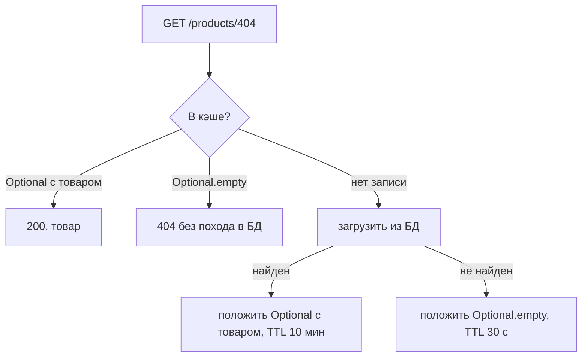

# Сценарий 8. Отрицательный кэш

Тест: `src/test/java/io/github/olaaa/cachinglab/scenario/Scenario8NegativeCachingTest.java`.
Сервис: `NegativeCachingProductService` (`FOUND_TTL` = 10 минут, `NOT_FOUND_TTL` = 30 секунд).
Ручная проверка: `http/08-negative-cache.http`.

## Ситуация

Товар 404 сняли с продажи и удалили, но ссылки на него остались в поисковиках, старых рассылках и закладках. Поисковые роботы перебирают адреса `/products/1`, `/products/2` и дальше подряд. Кто-то перебирает случайные id нарочно, чтобы нагрузить БД.

Обычный кэш здесь бесполезен: он запоминает найденные товары, а «товара нет» не запоминает. Каждый такой запрос проходит мимо кэша прямо в БД. Это называют проходом сквозь кэш (cache penetration).

## Почему обычный кэш не помогает

Источник возвращает пустой `Mono`, `toFuture()` превращает его в future с `null`. Caffeine запись с `null` не хранит: после завершения загрузки он её удаляет. Следующий запрос того же id снова идёт в источник.

## Что делает отрицательный кэш

Хранит и «нет» тоже — как `Optional.empty()`. Пустой `Optional` в отличие от `null` — обычное значение, и Caffeine его хранит.

```java
Caffeine.newBuilder()
        .ticker(cacheTicker)
        .maximumSize(10_000)
        .expireAfter(Expiry.<Long, Optional<Product>>writing(
                (key, value) -> value.isPresent() ? FOUND_TTL : NOT_FOUND_TTL))
        .buildAsync();
```

`Expiry.writing` задаёт срок жизни отдельно для каждой записи по её значению: найденный товар живёт 10 минут, «нет» — 30 секунд.



Почему «нет» живёт коротко. Товар 404 могут создать заново. Пока отрицательная запись жива, магазин будет отвечать «нет такого товара», хотя он уже есть. Короткий срок ограничивает эту ошибку.

## Что проверяют тесты

`ordinaryCacheDoesNotRememberMissingProduct`:

1. Пять раз читает товар 404 через обычный `CacheAsideProductService` — каждый раз пусто.
2. После каждого чтения ждёт, пока Caffeine удалит запись с `null`. Он делает это в колбэке завершения future, а колбэк может выполниться чуть позже, чем `block()` вернёт пустой ответ. Без ожидания следующее чтение иногда успевает получить ту же пустую future, и тест получался нестабильным.
3. Обращений к источнику — 5.

`negativeCacheRemembersMissingProduct`: пять чтений через отрицательный кэш — одно обращение.

`newProductStaysHiddenUntilNegativeEntryExpires`:

1. Читает 404 — пусто, в кэше `Optional.empty()`.
2. Ждёт, пока срок записи станет коротким: пока загрузка не завершилась, Caffeine держит запись с огромным сроком.
3. Создаёт товар 404 «Блендер» прямо в БД.
4. Читает — по-прежнему пусто: кэш помнит «нет».
5. Сдвигает часы на 31 секунду, читает — товар найден. Обращений — 2.

## Попробовать вручную

`http/08-negative-cache.http`:

1. Сброс, пять раз `GET /products/404?via=CACHE_ASIDE` — каждый раз 404, `sourceCalls` = 5.
2. Сброс, пять раз `GET /products/404?via=NEGATIVE` — `sourceCalls` = 1.
3. В терминале в папке проекта создать товар в обход приложения:

   ```bash
   docker compose exec postgres psql -U catalog -c "INSERT INTO product VALUES (404, 'Блендер', 4590.00)"
   ```

4. Повторять `GET /products/404?via=NEGATIVE`: до 30 секунд — 404, потом — 200.
5. Убрать товар: `docker compose exec postgres psql -U catalog -c "DELETE FROM product WHERE id = 404"`.

## Что важно заметить

- Если товар создаёт само приложение, отрицательную запись надо удалить сразу при создании — так же, как при изменении цены (сценарий 5). Короткий TTL — страховка для изменений в обход приложения.
- `maximumSize` обязателен: при переборе случайных id отрицательных записей может быть сколько угодно, и без ограничения кэш съест память.
- Альтернатива для очень большого множества id — фильтр Блума: компактная структура, которая точно знает, что id нет, и с небольшой вероятностью ошибается в сторону «может быть». Им отсекают заведомо несуществующие id до кэша и БД. Чаще встречается вместе с Redis.
- От злонамеренного перебора отрицательный кэш защищает плохо: каждый новый случайный id — всё равно промах. Против этого нужны ограничение частоты запросов (этап 3) и проверка формата id.

## Насколько часто встречается

Умеренно. Важен для публичного каталога, который индексируют поисковики и обходят боты, и для API, где клиенты часто спрашивают несуществующее. Во внутренних сервисах встречается редко.

## Как сказать на собеседовании

«Обычный кэш не хранит „не найдено“, и запросы несуществующих ключей идут мимо кэша в БД. Я кэширую и пустой результат, но с коротким TTL, чтобы новая запись не пряталась долго, и удаляю отрицательную запись при создании. Размер кэша ограничиваю. От перебора случайных ключей отрицательный кэш не спасает — там нужны ограничение частоты запросов или фильтр Блума».
