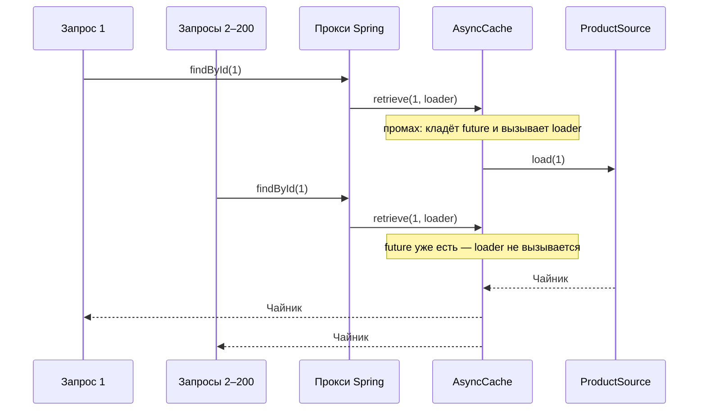

# Сценарий 9. `@Cacheable(sync = true)`

Тест: `src/test/java/io/github/olaaa/cachinglab/scenario/Scenario9SyncCacheableTest.java`.
Сервисы: `SyncCacheableProductService`, для сравнения — `AnnotatedProductService` из сценария 3. Настройка: `config/CacheConfiguration` (кэш `productsSync`).
Ручная проверка: `http/09-cacheable-sync.http` и команды `curl` ниже.

## Ситуация

Тот же `@Cacheable`, что в сценарии 3, но под нагрузкой. Началась распродажа, и за «Чайником», которого ещё нет в кэше, одновременно пришли двести покупателей. Без дополнительной настройки `@Cacheable` пропустит к источнику все двести запросов: это лавина промахов из сценария 6, только в декларативном кэше Spring.

## Почему `@Cacheable` без `sync` пропускает все промахи

Без `sync` прокси Spring делает две отдельные операции с кэшем:

1. посмотреть, есть ли значение по ключу;
2. если нет — вызвать метод и, когда он отдаст значение, положить его в кэш.

Между первым и вторым шагом проходит всё время загрузки. Все двести запросов успевают сделать шаг 1 раньше, чем первый дойдёт до шага 2, и каждый вызывает метод. Это наивный Cache-Aside из сценария 6.

## Что делает `sync = true`

```java
@Cacheable(cacheNames = CACHE_NAME, sync = true)
public Mono<Product> findById(long id) {
    return source.load(id);
}
```

С `sync = true` Spring вместо пары «прочитать, потом записать» вызывает одну операцию кэша `retrieve(key, valueLoader)`. Javadoc `Cache.retrieve`: «implementations should ensure that the loading operation is synchronized so that the specified valueLoader is only called once in case of concurrent access on the same key».

`CaffeineCache` в асинхронном режиме превращает её в `AsyncCache.get(key, loader)` — тот же приём, что в сценарии 2. Первый промах кладёт в кэш future загрузки, остальные получают эту же future и ждут её. Источник вызывается один раз.



### Ограничения

Javadoc `@Cacheable.sync`:

- `unless` не поддерживается;
- кэш можно указать только один;
- другие кэш-операции на том же методе комбинировать нельзя.

Это «hint»: объединит ли провайдер одновременные загрузки, зависит от провайдера. Caffeine объединяет.

## Ловушка: загрузка без подписки

С `sync = true` кэш опрашивается и загрузка на промахе запускается в момент вызова метода, а не при подписке на `Mono`. В `CacheAspectSupport.ReactiveCachingHandler.executeSynchronized` (Spring Framework 7.0.10):

```java
return adapter.fromPublisher(Mono.fromFuture(
        doRetrieve(cache, key,
                () -> Mono.from(adapter.toPublisher(invokeOperation(invoker))).doOnError(...).toFuture()))
```

`Mono.fromFuture` получает готовую future, а не лямбду, поэтому `doRetrieve` выполняется сразу, при вызове метода. На промахе Caffeine тут же вызывает загрузчик, а тот подписывается на `Mono` метода через `toFuture()`. Без `sync` вызов метода только собирает цепочку, и источник не трогается, пока нет подписки.

Обычно это незаметно: в WebFlux на `Mono` подписываются сразу. Но запись вида `cached.switchIfEmpty(service.findById(id))` при `sync = true` запустит загрузку при каждом вызове, даже если запасной вариант не понадобится. Защита — `Mono.defer(() -> service.findById(id))` в месте вызова.

## Что проверяют тесты

`cacheableWithoutSyncLetsEveryConcurrentMissThrough`: 200 одновременных чтений холодного товара через `AnnotatedProductService.findById` (без `sync`) — 200 обращений к источнику.

`cacheableWithSyncCoalescesConcurrentMisses`: те же 200 чтений через `SyncCacheableProductService.findById` — одно обращение.

`cacheableWithSyncStartsLoadingWithoutSubscription`:

1. `AnnotatedProductService.findById(1)` без подписки — обращений 0.
2. `SyncCacheableProductService.findById(1)` без подписки — обращений уже 1.
3. Две подписки на тот же `Mono` через `block()` — обращений по-прежнему 1: обе получают результат одной future.

Одновременные чтения устроены как в сценарии 6: `flatMap` с параллельностью 200 подписывается на все чтения сразу, не дожидаясь ответов (`ScenarioTestSupport.readConcurrently`).

## Попробовать вручную

Одиночный запрос с `sync` ведёт себя так же, как без него, поэтому в `http/09-cacheable-sync.http` только базовая проверка. Разница видна на одновременных промахах — в терминале, как в сценарии 6:

```bash
curl -s -X POST http://localhost:8080/lab/reset
seq 200 | xargs -P 200 -I{} curl -s -o /dev/null "http://localhost:8080/products/2?via=ANNOTATED"
curl -s http://localhost:8080/lab/stats

curl -s -X POST http://localhost:8080/lab/reset
seq 200 | xargs -P 200 -I{} curl -s -o /dev/null "http://localhost:8080/products/2?via=ANNOTATED_SYNC"
curl -s http://localhost:8080/lab/stats
```

Для `ANNOTATED` `sourceCalls` будет заметно больше 1 (точное число зависит от того, как быстро `curl` успеет открыть соединения), для `ANNOTATED_SYNC` — 1.

## Насколько часто встречается

`sync = true` ставят реже, чем стоило бы: по умолчанию он выключен, и без нагрузочного теста лавину промахов не видно. Нужен он для горячих ключей, которые дорого загружать: популярный товар во время распродажи, главная страница, справочники, которые читают все запросы. Это оценка по практике, а не статистика.

## Как сказать на собеседовании

«`@Cacheable` без `sync` — это два отдельных шага: прочитать и записать, поэтому одновременные промахи по одному ключу все идут в источник. С `sync = true` Spring вызывает одну операцию `retrieve(key, loader)`, и Caffeine загружает значение один раз, остальные ждут ту же future. Ограничения: нельзя `unless` и несколько кэшей. Для реактивных методов помню, что с `sync = true` загрузка начинается при вызове метода, а не при подписке».
